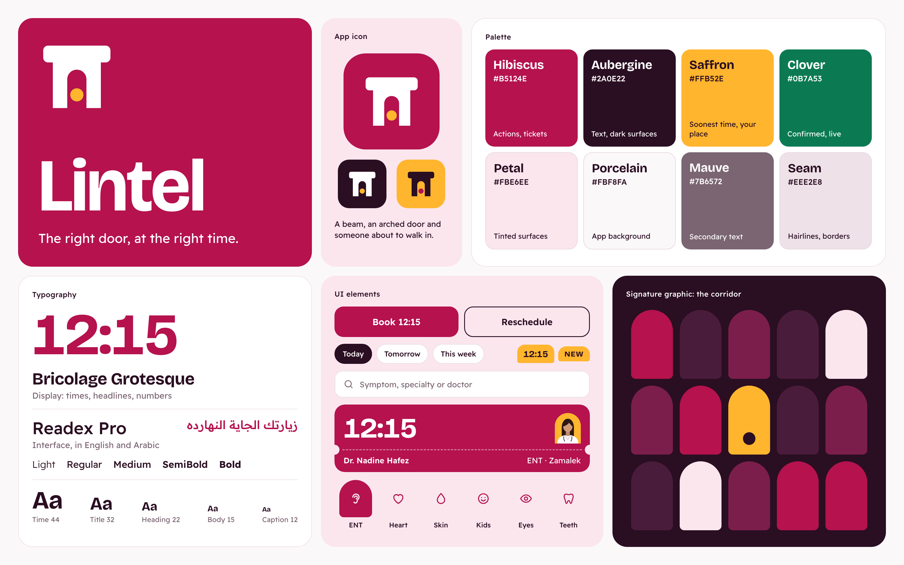
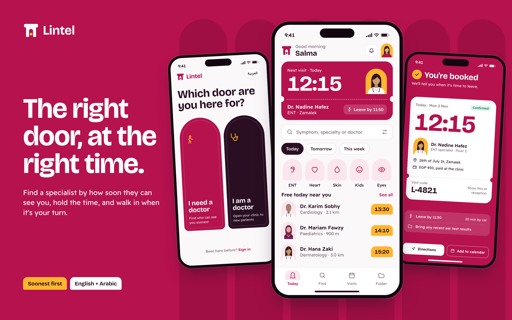
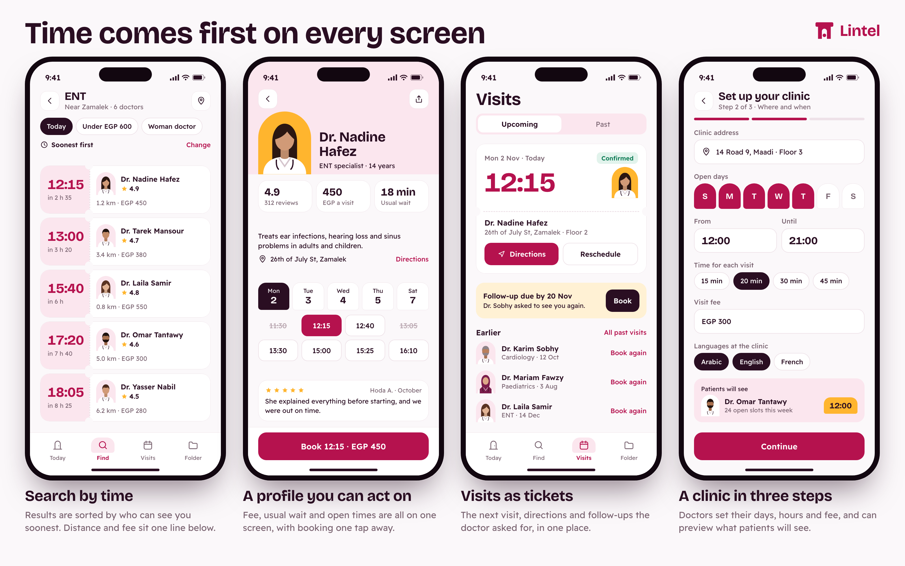
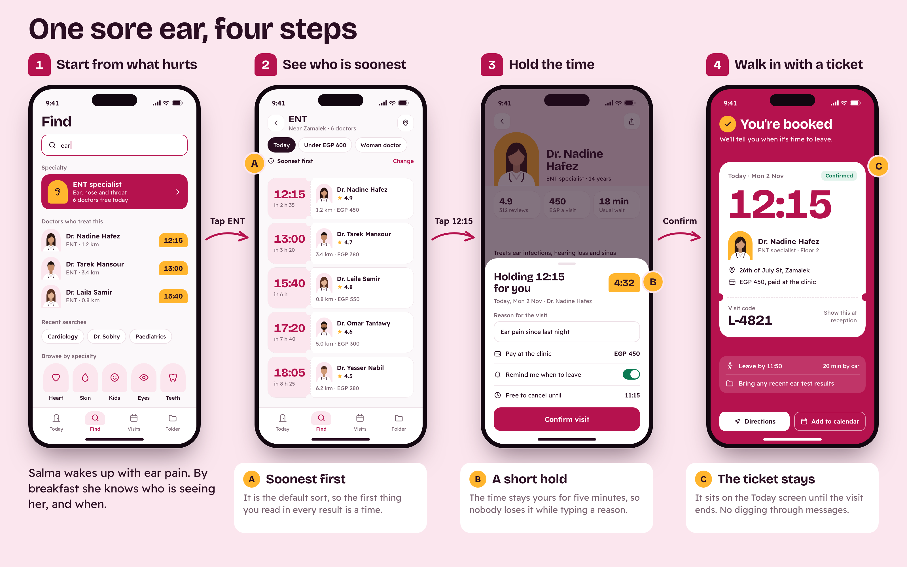
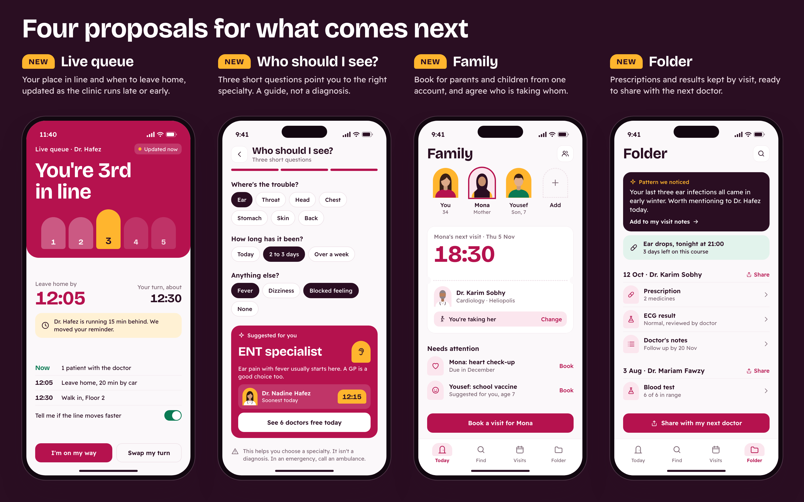
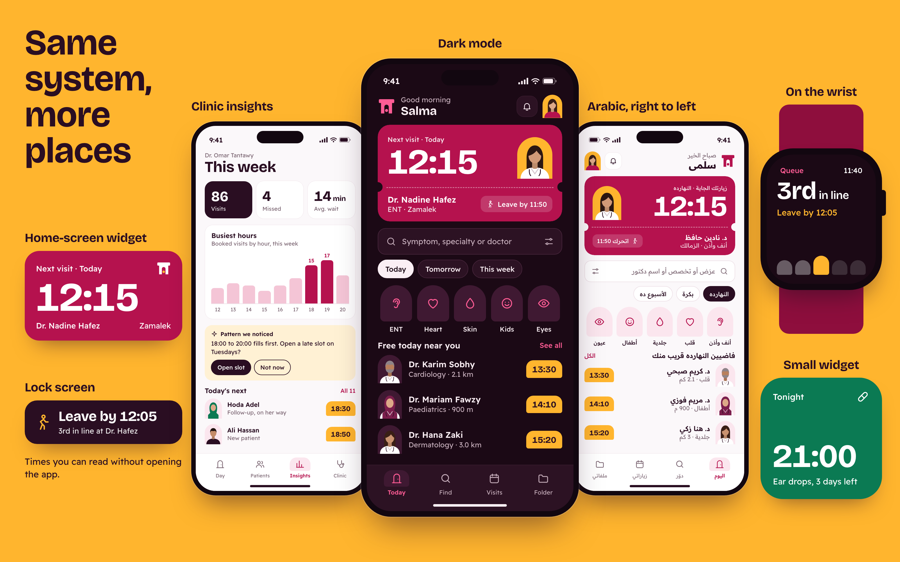

# Lintel

**The right door, at the right time.**

> **This is a product concept.** Lintel is not published on the App Store or Google Play, and it is not a medical device. All doctors, patients, clinics, prices and figures in the images are fictional.

## Introduction

Lintel is a doctor-booking app concept set in Cairo, with English and Arabic layouts. Most booking apps open on a directory of doctors. Lintel opens on a time: who can see you, and how soon.

A lintel is the beam above a doorway. The name comes from a simple picture of getting care: reaching the right door at the right moment. That picture runs through the logo, the arched shapes in the interface and the ticket you take to the clinic.

## What it does

- Finds nearby specialists and sorts them by the earliest time they can see you
- Holds a time for five minutes while you confirm it
- Gives you a ticket with the time, clinic, fee, visit code and when to leave
- Keeps upcoming visits, past visits and follow-ups in one place
- Lets doctors set up their clinic and preview what patients will see

## The problem

Many private clinics in Egypt still run on a first-come basis. You arrive, join the line and wait, often with no idea how long it will take. Calling ahead helps, but only during reception hours and only one clinic at a time.

Directory-style booking apps solve part of this, but you still have to open profile after profile to learn when someone is free. When your ear hurts at breakfast, you don't need every ENT doctor in the city. You need to know who can see you today.

## Who it's for

- **People who need a doctor soon** and would rather compare real times than phone around
- **Adults arranging care for others**, such as a parent or a young child
- **Doctors running private clinics** who want a fuller schedule and fewer empty slots, without a long setup

## Main features (redesigned)

These are the core flows of a doctor-booking product, designed from scratch around time.

- **Search by time.** Results are sorted soonest first. The time is the first thing you read; rating, distance and fee come after it.
- **Doctor profile.** Fee, usual wait, clinic address, open times and a recent review share one screen, with the booking button always in reach.
- **Visits as tickets.** The next visit looks like a ticket, with directions and rescheduling on it. Follow-ups the doctor asked for appear just below.
- **Clinic setup.** Doctors set their address, days, hours, visit length, fee and languages in three steps, with a preview of what patients will see.

The main journey takes four steps: start from what hurts, see who is soonest, hold the time, then walk in with a ticket.

## New proposed features

**These are proposals. None of them is implemented.**

- **Live queue.** Shows your place in line and when to leave home, and moves your reminder when the clinic runs late.
- **Who should I see?** Three short questions lead to a "Suggested for you" specialty. It helps you choose where to start and says clearly that it isn't a diagnosis.
- **Family.** Book for parents and children from one account, see what each person needs next, and agree who is taking whom.
- **Folder.** Keeps prescriptions and results by visit, ready to share with the next doctor. A "Pattern we noticed" card points out things worth raising at the next appointment.

Also proposed: dark mode, a full Arabic right-to-left layout, clinic insights for doctors, and a watch view and widgets that show the time without opening the app.

## From prototype to product

| Area | Where the concept is today | What launch would take |
| --- | --- | --- |
| Research | Design reasoning, no user testing yet | Interviews and usability tests with patients, doctors and reception staff |
| Doctors | Fictional sample profiles | Licence checks and signed-up clinics |
| Availability | Screens assume every clinic's times are current | An easy way for clinics to keep times up to date, including walk-ins |
| Live queue | Screen concept | A pilot with a few clinics to see how reception would update the line |
| Specialty guide | Sample questions | Medical review of every question and suggestion |
| Health records | Sample records | Patient consent, a privacy review and compliance with local data protection law |
| Language | English screens and one Arabic screen | Full Arabic copy, tested with older patients |
| Business model | Not defined | A decision on who pays: clinics, patients or both |

## The concept and its value

Lintel rests on one decision: show the time first. For patients, the aim is less guessing and less sitting in a crowded waiting room. For clinics, the aim is a fuller schedule and patients who arrive when they're expected.

Healthcare apps often look pale blue and clinical. Lintel takes its main colour from hibiscus, the flower behind the karkadeh tea served across Egypt, and pairs it with deep aubergine. Saffron is saved for what matters most: the soonest time and your place in line. Arches come from doorways, perforated edges come from paper tickets, and large numerals keep the time readable at a glance. Times and headlines use Bricolage Grotesque. Interface text uses Readex Pro, which covers both English and Arabic.

**Palette**

- Hibiscus `#B5124E`: actions, tickets
- Aubergine `#2A0E22`: text, dark surfaces
- Saffron `#FFB52E`: soonest time, your place in line
- Clover `#0B7A53`: confirmed and live states
- Petal `#FBE6EE`: tinted surfaces
- Porcelain `#FBF8FA`: app background
- Mauve `#7B6572`: secondary text
- Seam `#EEE2E8`: hairlines, borders

---

Product concept by Ziad Abdellah.
